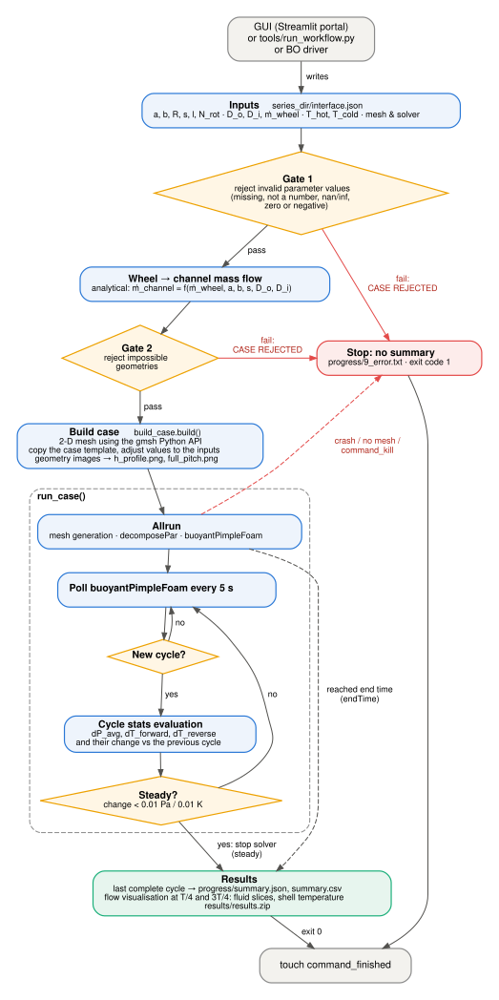
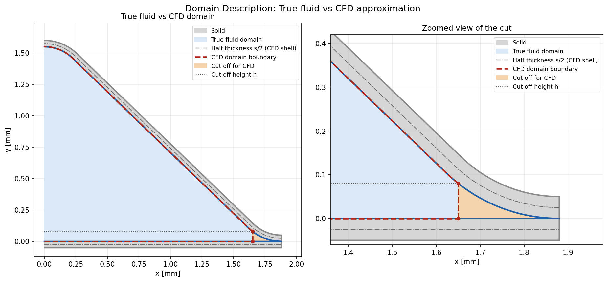
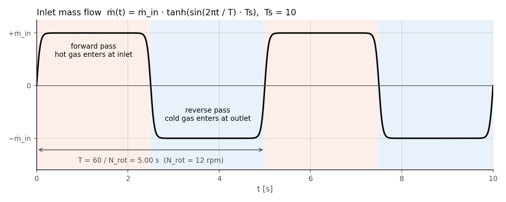
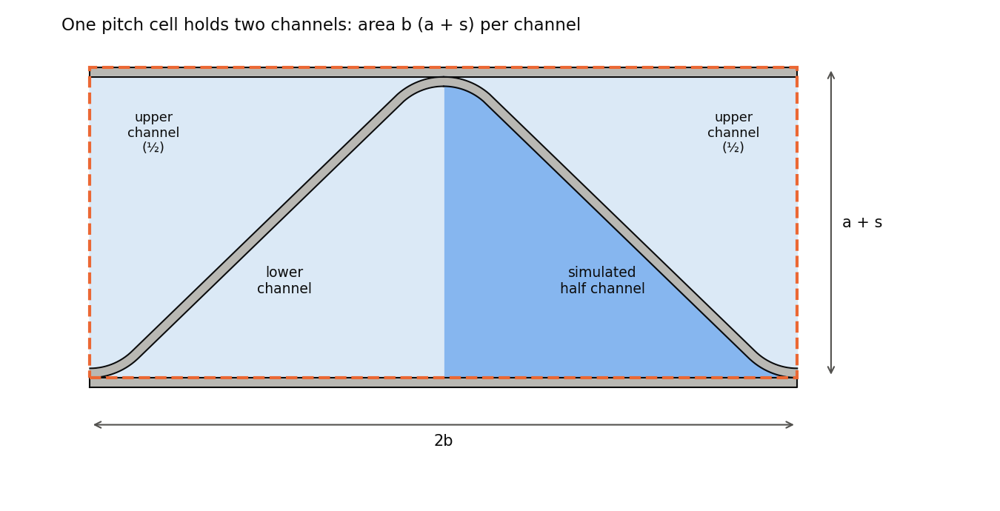
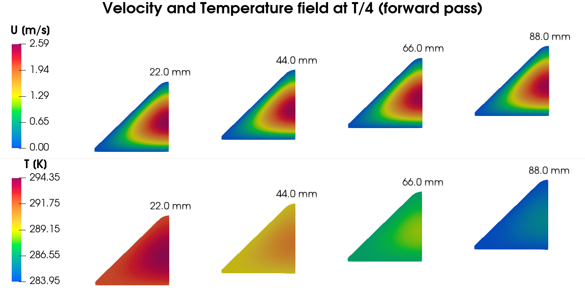
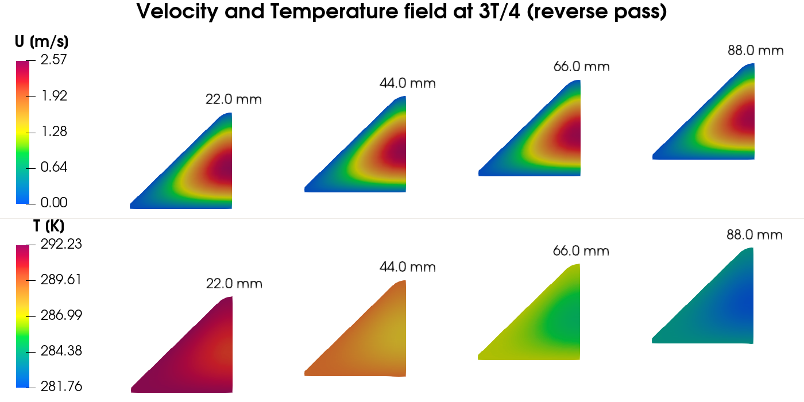
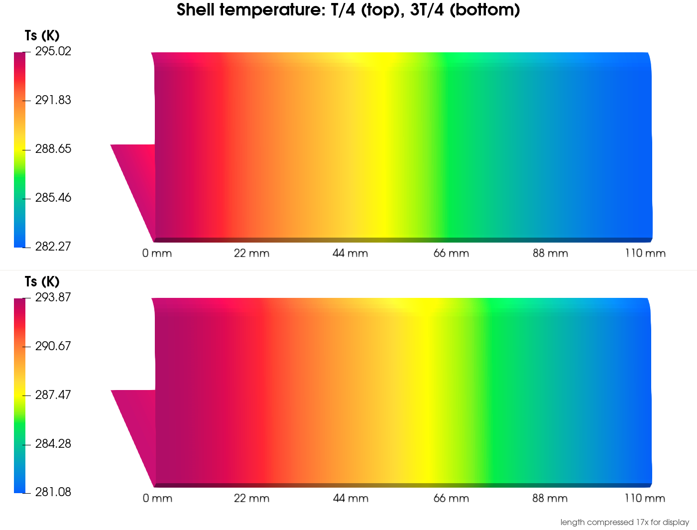
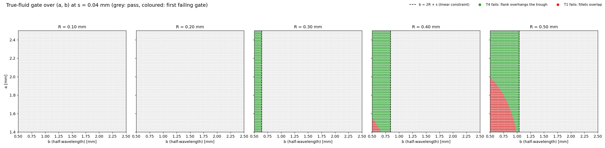
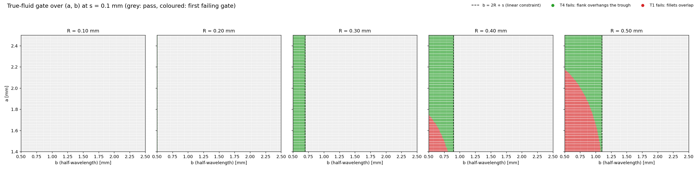

# Microchannel workflow

This report describes the `microchannel` workflow (`workflows/microchannel/`)
from the input form to a Bayesian-optimisation (BO) loop around it. It covers
how the per-channel mass flow is derived, how inputs are gated, when the
solver is stopped, which parameters a BO study should vary within which
practical bounds, the two objectives, and how failed or infeasible cases
should be handled.

To run the nominal channel, run the following command from the repository root:

```bash
python3 tools/run_workflow.py microchannel \
        examples/microchannel_default.json --name microchannel_default
```

Results are written to `runs/microchannel_default/`.

---

## 1. Pipeline at a glance




---

## 2. Input parameters

A run is driven by a JSON input file. The nominal channel is given in
[`examples/microchannel_default.json`](../../examples/microchannel_default.json).
Its values are the defaults listed in the table: the heat wheel HX5 of
Zmrhal et al. [1, 2] at its lowest airflow and the standard speed of
12 rpm. The papers do not give R; 0.32 mm is assumed.

The stream mass flow is set to 0.503 kg/s instead of the nominal
1 400 m³/h, so that the channel inlet velocity matches the paper's CFD
(sec. 7).

| Group | Field | Default | Role |
|---|---|---|---|
| Geometry | `channel height a [mm]` | 1.6 | height to the outer crest of the foil |
| | `half-wavelength b [mm]` | 1.88 | crest at x = 0, trough at x = b |
| | `crest fillet radius R [mm]` | 0.32 | forming-tool radius |
| | `foil gauge s [mm]` | 0.05 | **full** foil thickness t |
| | `channel length l [mm]` | 110 | wheel depth = Z extrusion length |
| Operation | `wheel speed N_rot [rpm]` | 12 | period T = 60 / N_rot of the flow reversal |
| | `wheel_outer_diameter D_o [mm]` | 1010 | wheel face, used for the channel count |
| | `wheel_inner_diameter D_i [mm]` | 120 | hub, used for the channel count |
| | `stream mass flow rate mdot [kg/s]` | 0.503 | mass flow of one stream, split over the channels of half the wheel face |
| | `hot inlet temperature [K]` | 298 | T_h1, enters at the inlet patch (forward pass) |
| | `cold inlet temperature [K]` | 278 | T_c1, enters at the outlet patch (reverse pass) |
| | `initial temperature [K]` | 288 | initial foil (shell) temperature |
| Mesh & solver | `mesh refinement r` | 1.0 | mesh density; cell sizes scale as 1/r |
| | `maxCo` | 1 | Courant limit of the adjustable time step |
| | `nCorrectors` | 2 | PIMPLE pressure correctors |
| | `end time [s]` | 150 | hard limit on simulated time |
| Run-time | `number of processors` | 12 | MPI ranks (1 = serial) |

---

## 3. True geometry to CFD domain

The inputs describe the real wheel: its corrugated foil, its speed and its
air flow. `build_case.build()` turns them into the CFD case.

### 3.1 Mesh: approximating the true cross-section

The true fluid domain of one channel is bounded by the base sheet, the
trough fillet (radius R + s), the straight flank and the crest fillet
(radius R); the flank is the common tangent of the two fillets. The channel
is symmetric about its crest, so the CFD domain is **half a channel**,
x = 0 … b, with a symmetry plane at x = 0.

Near the trough the true domain narrows to a wedge of zero thickness,
which would cost many cells and carries almost no flow. The mesher replaces
it with a **vertical cut**:

1. fix a cut height h = 0.05 · min(a, b) above the floor;
2. follow the true wall from the crest down to the point Q where it reaches
   y = h;
3. drop a vertical wall from Q to the floor. The sliver beyond it is left
   out of the fluid domain.

Every case writes this comparison as `h_profile.png` into its case folder.
For the default case:



The dashed red line is the CFD domain; the orange sliver is what the cut
removes; the dash-dot line marks half the foil thickness.

The foil is not meshed as a solid. The channel wall carries a finite-area
**thermal shell** of thickness **s / 2**. Each foil separates
two channels, so each channel stores half of it.

### 3.2 Time period from the wheel speed

As the wheel turns, a channel spends half a revolution in the hot stream
and half in the cold stream, which flows the opposite way. One revolution
is one period of the simulation:

```math
T = \frac{60}{N_{rot}} \quad [\mathrm{s}]
```

The period drives the **velocity boundary condition**. Both ends of the
channel use the same signal, which reverses the flow every half period:

```math
\dot m(t) = \dot m_{in}\, \tanh\!\left(\sin\!\left(\frac{2\pi t}{T}\right) T_s\right),
\qquad T_s = 10
```



### 3.3 Mass flow through the simulated channel

The input is the mass flow of one stream (hot or cold). Each stream passes
half of the wheel face, so its flow is spread evenly over the channels in
that half, and the simulated domain is half of one channel.



One pitch of the corrugation is 2b wide and a + s high and holds **two** channels: the lower channel and two halves of the inverted upper channel. Each channel
therefore occupies b (a + s) of the wheel face. The approximate total number of channels can then be evaluated using:

```math
N_{ch} = \frac{\pi \left(D_o^2 - D_i^2\right)}{4\, b\, (a + s)}
```

A stream passes N_ch/2 of these channels, and the simulated domain is half
of one channel, so it receives

```math
\dot m_{in} = \frac{1}{2}\cdot\frac{\dot m_{stream}}{N_{ch}/2} = \frac{\dot m_{stream}}{N_{ch}}
```

---

## 4. Gate checks

These checks reject inputs that cannot be simulated: invalid values
(gate 1) and impossible geometries (gate 2). They run before any meshing.
A rejected case stops with exit code 1, writes `progress/9_error.txt` and
creates `command_finished`; no case folder, summary or zip is produced.

**Gate 1, parameter values** (`true_geometry.check_parameter_values`). Each of
a, b, R, s, l, N_rot must be a finite positive number. A failure adds

```
>>> CASE REJECTED (invalid values): N_rot = 0.0 must be positive
```

to `progress/1_info.txt` and raises `ValueError`. A separate check requires
0 ≤ D_i < D_o.

**Gate 2, true geometry** (`true_geometry.check_true_geometry`). Values that are fine one by one may
still not form a channel. So this gate checks if a valid geometry can be constructed.

```
>>> CASE REJECTED (impossible geometry): T1 fillets overlap: r_c+r_t=1.05 > L=0.75: no straight flank exists
```

in `progress/1_info.txt`, followed by a detailed `ValueError` in `progress/9_error.txt`. 

Rather than letting the BO learn the infeasible region from penalised cases, which wastes trials, gate 2 is turned into a linear constraint for the optimiser (sec. 8.4.2).

---

## 5. Running and stopping the simulation

The flow reverses every half period, so the solution never becomes steady
in the usual sense. It becomes **periodic**: after a number of cycles every
cycle repeats the previous one. How many cycles that takes differs from
case to case, so a suitable end time cannot be known in advance, and a
generous one wastes compute. The run is therefore stopped as soon as the
periodic state is reached.

While the solver runs, `run_case()` checks every `KILL_POLL_S` = 5 s
whether another full cycle has been completed. After each completed cycle
it evaluates the cycle statistics:

- **dP_avg**: the pressure drop, averaged over the forward and the reverse
  pass;
- **eps**: the effectiveness, mean of the forward (hot) and reverse (cold)
  value (sec. 8.3);
- **imbalance** ε_f − ε_r: the part of the foil's heat storage that is
  still unbalanced (Appendix A). It is printed, not tested;

and how much dP_avg and eps changed against the previous cycle. Each
cycle is added to `progress/1_info.txt`. The forward and reverse values
approach each other from opposite sides, so their mean settles before
either does. The case counts as steady when both changes are below their
tolerance (`STEADY_TOL`):

```math
|\Delta\, dP_{avg}| < 0.01\ \mathrm{Pa}, \qquad
|\Delta\, \varepsilon| < 0.0005
```

The solver is then stopped and the results of the last complete cycle are
written.

`end time [s]` remains as an upper limit in case the criterion is never
met. A run can end in four ways:

| Outcome | Trigger | Result |
|---|---|---|
| `steady` | both changes below their tolerance | solver stopped, summary written |
| `endTime` | `end time [s]` reached before the criterion was met | summary written, flagged "not steady by the criterion" |
| `killed` | `command_kill` file appeared (user cancel or timeout) | solver stopped, **no summary**, exit code 1 |
| failure | Allrun failed, no mesh, or the solver never advanced a time step | `CASE FAILED` in the log, `9_error.txt`, exit code 1 |

Stopping the solver stops the whole process group (all MPI ranks).

---

## 6. Flow visualisation

At the end of every run the workflow writes three images of the last
complete cycle, at the middle of the forward (hot) pass, T/4, and the
middle of the reverse (cold) pass, 3T/4. They are copied to `progress/`
and included in `results/results.zip`.

| Image | Shows |
|---|---|
| `fluid_slices_T4.png`, `fluid_slices_3T4.png` | velocity magnitude \|U\| (top) and temperature T (bottom) on four cross-sections at 0.2, 0.4, 0.6 and 0.8 l, labelled with their distance from the inlet |
| `shell_temperature.png` | foil temperature T_s on the wetted wall at T/4 (top) and 3T/4 (bottom); the channel length is compressed for display, the labels give the true distance from the inlet |

The images below are generated by the nominal run (the defaults of sec. 2).







---

## 7. Comparison with reference paper

The default nominal case is the HX5 heat wheel of Zmrhal et al. [1, 2].
Its results are compared here with the CFD results of [2], to check that
the workflow reproduces a published case.

### 7.1 Matching the flow

The input mass flow rate is changed from the nominal 0.467 kg/s
(1 400 m³/h) to 0.503 kg/s. The paper divides the stream mass flow into
the microchannels differently from this workflow, possibly because it
uses a different effective diameter, whereas the workflow computes the
channel count solely from the inner and outer diameter (sec. 3.3). At
1 400 m³/h the paper's channels therefore carry about 8 % more flow than
the workflow's. To have the same mean velocity at the channel inlet, the
stream mass flow rate is scaled to match it:

```math
\dot m_{stream} = u\, \rho\, A_{in}\, N_{ch}
```

with u the paper's inlet velocity, ρ the air density at the inlet
temperature, A_in the inlet area of the simulated half channel and N_ch
the channel count of sec. 3.3.

### 7.2 Results

| Quantity | This workflow | Paper [2] |
|---|---|---|
| inlet velocity, hot / cold [m/s] | 1.179 / 1.100 | 1.178 / 1.098 (Table 4) |
| pressure drop Δp [Pa] | 32.4 | 32 (Table 10) |
| effectiveness ε [%] | 77.4 | 75 (Table 9) |

Both use area-weighted outlet temperatures. The paper's Δp is from an
isothermal run at 20 °C.

The pressure drop agrees to within 0.4 Pa (about 1 %). The
effectiveness computed here is about 2.4 points higher. One reason may be
the modelling differences between the two simulations:

- the flow reverses through a smooth ramp here, while [2] interchanges
  constant-velocity inlet and outlet conditions at the end of each phase;
- the foil is a thin thermal shell here, and a meshed solid in [2].

---

## 8. Bayesian optimisation

To optimise the wheel, the workflow is run inside a Bayesian-optimisation
(BO) loop: a surrogate model proposes a set of parameters, the workflow
simulates it, and the result updates the surrogate for the next proposal.
This section covers which parameters the optimiser varies and which stay
fixed, practical parameter bounds and the two objectives.

### 8.1 Classification of input parameters

Each input is either a **continuous** or **discrete** design variable that
the optimiser changes, a **fixed operating point** that defines the duty
the wheel is designed for, or a fixed numerical setting.

| Parameters | Type | Note |
|---|---|---|
| a, b, R, l, N_rot | **continuous** | design variables |
| s | **discrete** | standard foil gauges (0.05 / 0.055 / 0.07 / 0.1 mm); a discrete variable, or fixed at 0.05 mm, the optimum of De Antonellis et al. [3] |
| ṁ_stream, T_hot, T_cold | **fixed operating point** | - |
| D_o, D_i | **fixed** | fixed by the air-handling unit the wheel must fit; they set only the channel count N_ch and hence the per-channel mass flow |
| T_init | fixed | foil start temperature only |
| r, maxCo, nCorrectors, end time, n_proc | fixed | numerical settings; must not change during a study |

### 8.2 Practical parameter bounds

The design space given to the BO should only contain wheels that can be
manufactured and operated. The bounds below come mainly from the two
studies of Zmrhal et al. [1, 2], which built, measured and simulated
aluminium heat wheels with the same channel shape, supplemented by an
optimisation study [3] and manufacturer data [4, 7, 8]. All lengths use
this workflow's conventions: b is the half-wavelength and s the full foil
thickness.

| Parameter | Practical bound | Basis |
|---|---|---|
| a (channel height) | **1.4 – 2.5 mm** | "common microchannel height is in the range of 1.4 to 2.3 mm" [2]; manufacturers offer wave heights of 1.4 – 2.5 mm [4, 7]; tested wheels 1.6 – 1.9 mm [1] |
| b (half-wavelength) | **1.5 – 2.5 mm** | tested wheels have a wavelength of 3.70 – 3.76 mm, i.e. b = 1.85 – 1.88 mm [1, 2]; a channel period of 3.5 mm, b = 1.75 mm, in [3]. No source gives an explicit range; the bound brackets these values (wavelength 3 – 5 mm) |
| R (crest fillet radius) | **0.1 – 0.5 mm** | no published value. A sinusoidal wave with the tested height and wavelength has a crest radius of about 0.43 mm; 0.1 mm stands for a nearly sharp fold |
| s (foil thickness) | **0.04 – 0.10 mm** (discrete) | "aluminium sheet or aluminium foil with a thickness in the range of 0.04 to 0.1 mm" [2]; 0.05, 0.055, 0.07 and 0.1 mm used in [1]; 0.05 mm is the thinnest with sufficient mechanical strength and the optimum in [3] |
| l (wheel depth) | **100 – 200 mm** | "usually in the range of 100 to 200 mm, while 200 mm is the standard depth" [2]; manufacturers offer 100, 150, 200 and 250 mm [7, 8]; 110 – 200 mm tested [1, 2]. No datasheet below 100 mm was found |
| N_rot (wheel speed) | **0.5 – 20 rpm** | speed is controlled "typically within a range of 0 to 20 rpm" and "a reduced rotational speed (below 1 rpm) can also be used for frost protection" [1]; standard speed 12 rpm, lowering it is a frost-protection measure [7]; highest effectiveness at 10 – 16 rpm [1] |
| ṁ_stream (air flow of one stream) | **0.47 / 0.93 / 1.37 kg/s** | the three measured and simulated airflows of [1, 2], 1 400 / 2 800 / 4 200 m³/h (1 680 / 3 360 / 4 920 kg/h) for D_o = 1010 mm; they correspond to face velocities of 1 / 2 / 3 m/s, the normal range in ventilation [2, 7] |
| D_o, D_i (wheel diameters) | e.g. **1010 / 120 mm** | the tested wheel [1, 2]; wheels are made from 200 to 6000 mm [2], one manufacturer's range is 200 – 3800 mm [7]. Fixed |
| T_hot / T_cold | **298 / 278 K** | the conditions of the measurements and CFD of [1, 2] (25 / 5 °C) |


### 8.3 Objectives

The workflow computes two objectives and writes them to each case's
`progress/summary.json` as `dP_avg` and `eps`:

| Objective | Direction | Definition |
|---|---|---|
| pressure drop `dP_avg` | minimise | mean of the forward- and reverse-pass \|Δp\| over the last complete cycle [Pa] |
| effectiveness ε | maximise | mean of the hot- and cold-side effectiveness, below |

The sensible effectiveness is the temperature change of one stream divided
by the largest possible change, the difference of the two inlet
temperatures. It can be evaluated on either stream:

```math
\varepsilon_h = \frac{T_{h1} - T_{h2}}{T_{h1} - T_{c1}}, \qquad
\varepsilon_c = \frac{T_{c2} - T_{c1}}{T_{h1} - T_{c1}}
```

with T_h1 / T_c1 the hot / cold inlet temperatures and T_h2 / T_c2 the
outlet temperatures of the two streams. Each temperature is the area
average over the inlet or outlet face, averaged over the pass, as in [2].
For balanced flow (the same ṁ in both directions, constant c_p) at the
periodic steady state, the foil stores no net heat per cycle, so the hot
stream's drop equals the cold stream's rise, T_h1 − T_h2 = T_c2 − T_c1,
and ε_h = ε_c.

In the nominal run this equality is not reached exactly: ε_h = 0.770 and
ε_c = 0.777, a remaining difference of about 0.96 % (Appendix A). The two
approach each other from opposite sides, so their mean settles before
either does. The objective therefore uses the mean of both, which is also
the quantity the steady-state criterion tests (sec. 5):

```math
\varepsilon = \frac{\varepsilon_h + \varepsilon_c}{2}
```

For the nominal run, ε = 0.7737 and dP_avg = 32.40 Pa. With
mass-flow-weighted instead of area-averaged outlet temperatures, ε is
0.7637 (Appendix A).

### 8.4 Failed and infeasible cases

Not every proposed parameter set produces a result, and the BO handles two
kinds of failure differently:

- failures that cannot be predicted (the solver diverges, the mesh fails,
  the run times out) are **penalised** after the fact (sec. 8.4.1);
- geometries that cannot exist are known before anything is run and are
  excluded by a **linear constraint**, so no trial is spent on them
  (sec. 8.4.2).

#### 8.4.1 Penalty for failed cases

The BO reads both objectives from each case's `progress/summary.json`. A
case counts as successful when the run ended with exit code 0, the summary
exists and both objectives are numbers. Every other case (a gate
rejection, a crash or mesh failure, a timeout or cancelled run, a run
shorter than one cycle) receives a **penalty**, which tells the surrogate
that this region is poor: for each objective, the worst successful value
seen so far plus 10 % of the observed range, on its bad side (higher
pressure drop, lower effectiveness). The penalty is recomputed every
iteration, so it stays just beyond the real results instead of a fixed
constant that would distort how the data are scaled.

Runs that reach the end time without meeting the steady criterion
(`stop_reason = "endTime"`) currently count as successful; they are logged
so that they can be inspected later.

A penalty is the right tool for failures nobody can predict. For
impossible geometries it would also work, but the BO would have to find
the forbidden region by trial and error, spending one run on every point.

#### 8.4.2 Geometric infeasibility: a linear constraint

Gate 2 failures are known **before** anything is run. A study of the gate
(Appendix B) shows that the whole failure region
reduces to one linear condition: the half-wavelength must leave room for
the crest fillet (radius R) and the trough fillet (radius R + s) side by
side,

```math
b - 2R - s \;\ge\; \delta, \qquad \delta = 0.01\ \mathrm{mm}
```

On the line b = 2R + s the result depends on round-off, hence the small margin δ. Inside the
practical bounds the constraint never becomes active (the smallest b,
1.5 mm, exceeds the largest 2R + s, 1.10 mm), but it is passed to the
optimiser anyway: it costs nothing and keeps the study safe if the bounds
are widened.

**During the BO phase.** In BoTorch the constraint is given to the
acquisition optimiser (`optimize_acqf`, argument `inequality_constraints`)
[5]. It acts on the **acquisition optimisation**, not on the GP model: the
GP is fitted to the evaluated points as before, and the optimiser never
proposes a point on the infeasible side; BoTorch also starts its internal
search only from points inside the constraint [6].

**During the initial sampling.**
The constraint only takes effect once the GP is used. The initial trials are drawn by Latin-hypercube (or Sobol)
sampling, which only knows the box bounds and can produce points that
violate it. They are therefore filtered by rejection sampling: every
drawn point is tested against b − 2R − s ≥ δ, points that fail are
discarded and replaced by new draws until the required number remains.
Inside the practical bounds no point is rejected.

---

## Appendix A. Hot drop versus cold rise

For balanced flow (the same ṁ both ways; constant c_p, which holds here)
at a periodic steady state, the foil stores no net heat per cycle, so the
hot drop T_h1 − T_h2 must equal the cold rise T_c2 − T_c1 and ε_h = ε_c
(sec. 8.3). The nominal run shows a small difference that decays only
slowly, cycle by cycle:

| Cycle | Hot drop T_h1 − T_h2 [K] | Cold rise T_c2 − T_c1 [K] | Imbalance [K] | Imbalance [%] |
|---|---|---|---|---|
| 0 | 10.064 | 14.155 | −4.091 | −33.78 |
| 1 | 14.063 | 15.225 | −1.161 | −7.93 |
| 2 | 14.920 | 15.534 | −0.614 | −4.03 |
| 3 | 15.202 | 15.595 | −0.394 | −2.56 |
| 4 | 15.313 | 15.589 | −0.276 | −1.78 |
| 5 | 15.368 | 15.569 | −0.201 | −1.30 |
| 6 | 15.400 | 15.549 | −0.149 | −0.96 |

- **Cycles 0 – 4**: the foil is still giving net heat to the gas; the
  imbalance falls from −4.09 K to −0.28 K.
- **Cycles 5 – 6**: the imbalance keeps shrinking by a factor of about
  0.73 per cycle. The run stops after cycle 6, when ε changes by less
  than 0.0005 (sec. 5), with −0.149 K (−0.96 %) left. The mean of the
  two, and with it ε, has settled by then: the hot drop and the cold
  rise approach it from opposite sides.

The imbalance does not come from how the face temperatures are averaged.
With mass-flow-weighted face temperatures (`absWeightedAverage` with
`weightField phi`) instead of area-averaged ones, cycle 6 gives a hot
drop of 15.198 K and a cold rise of 15.352 K: both are 0.20 K lower, the
imbalance is the same, and ε drops from 0.7737 to 0.7637.

---

## Appendix B. A linear constraint for the geometry gate

We try to identify linear constraints on a, b, R and s that reject
impossible geometries before a case is run. A linear constraint can be
passed directly to the optimiser (sec. 8.4.2), so the BO never proposes
such a geometry.

**Two checks cause the rejections.** The fluid-facing wall of the channel
consists of two arcs joined by a straight flank: the crest fillet, a
circle of radius R centred below the apex at x = 0, and the trough fillet,
a circle of radius R + s centred above the floor at x = b. The flank is
the straight line that touches both circles, crossing between them (their
internal common tangent). Of the checks in gate 2 (`check_true_geometry`),
mainly two reject a geometry as not manufacturable:

- **T1, the fillets overlap.** The tangent only exists if the distance
  between the two centres is at least the sum of the radii, 2R + s. The
  centres are b apart horizontally and a − 2R − 2s vertically, so T1 fails
  when

  ```math
  b^2 + (a - 2R - 2s)^2 < (2R + s)^2
  ```

  a disc in the (b, a) plane around a = 2R + 2s: medium-height channels,
  where the two centres sit nearly level.
- **T4, the flank overhangs the trough.** In taller channels the centres
  are far enough apart for a tangent, but it reaches the trough arc from
  the wrong side, and the flank would form an undercut. This has no simple
  closed form.

**Stress test.** The gate was evaluated on a grid of 111 × 201 × 41 points
over a = 1.4 – 2.5 mm, b = 0.5 – 2.5 mm and R = 0.1 – 0.5 mm, for the
thinnest and the thickest foil (s = 0.04 and 0.10 mm). Grey points pass,
red points fail T1, green points fail T4; the dashed line is b = 2R + s.





| | s = 0.04 mm | s = 0.10 mm |
|---|---|---|
| failing points | T1 9 829, T4 77 192 | T1 20 692, T4 85 957 |
| failing points with b > 2R + s | **0** | **0** |
| passing points with b < 2R + s | **0** | **0** |
| largest failing b | 1.04 mm = 2R_max + s | 1.10 mm = 2R_max + s |

**One linear constraint covers all points.** Horizontally the crest circle
occupies −R ≤ x ≤ R and the trough circle b − (R + s) ≤ x ≤ b + (R + s).
Both failures need these ranges to overlap, i.e. b ≤ 2R + s. The stress
test shows that the converse holds as well: every point below the line
fails and every point above it passes. The gate therefore reduces to the
single linear condition

```math
b - 2R - s > 0
```

On the line itself the result depends on round-off, so a small margin is
used: b − 2R − s ≥ δ with δ = 0.01 mm.

---

## References

1. V. Zmrhal, J. Kubenthiran, P. Zelenský, "Sensible heat effectiveness of
   rotary heat exchangers at low rotational speeds", *Energy & Buildings*
   342 (2025) 115905. (`Literature/Zmrhal2025.pdf`; Table 2 geometry,
   Table 3 and 8 boundary conditions.)
2. V. Zmrhal, P. Zelenský, J. Boháč, M. Barták, M. Kučera, R. Vavřička,
   "Determination of the sensible heat effectiveness and pressure loss of a
   rotary regenerative heat exchanger using CFD", *Building Simulation* 16
   (2023) 869–887, [doi:10.1007/s12273-022-0983-z](https://link.springer.com/article/10.1007/s12273-022-0983-z).
   (`Literature/s12273-022-0983-z.pdf`, sec. 2.)
3. S. De Antonellis, M. Intini, C. M. Joppolo, C. Leone, "Design
   optimization of heat wheels for energy recovery in HVAC systems",
   *Energies* 7(11) (2014) 7348–7367, [doi:10.3390/en7117348](https://doi.org/10.3390/en7117348).
4. Eri Corporation, "Rotary wheel heat exchanger", product information,
   [ericorporation.com](https://ericorporation.com/products/rotary-heat-exchanger/)
   (wave heights 1.4 – 2.5 mm).
5. BoTorch documentation, `botorch.optim.optimize_acqf` (format of
   `inequality_constraints`),
   [botorch.readthedocs.io/en/latest/optim.html](https://botorch.readthedocs.io/en/latest/optim.html).
6. BoTorch source, `botorch/optim/initializers.py`
   (`gen_batch_initial_conditions` uses `sample_q_batches_from_polytope`
   when constraints are given),
   [github.com/pytorch/botorch](https://github.com/pytorch/botorch/blob/main/botorch/optim/initializers.py).
7. Heatex AB, "Rotary heat exchangers – technical information", version 2
   (2025),
   [heatex.com](https://www.heatex.com/wp-content/uploads/2023/03/Rotary-Heat-Exchangers-Technical-Information-English.pdf)
   (face velocity 1 – 3 m/s, well heights 1.4 – 2.5 mm, depths 100 – 200 mm,
   diameters 200 – 3800 mm, standard speed 12 rpm, maximum pressure drop
   300 Pa, speed reduction against frost).
8. Enventus / Mastervent, "Rotary heat exchangers – product catalogue",
   [mastervent.fi](https://www.mastervent.fi/File/esitteet_varaosat_komponentit/Enventus-roottorit_katalogi.pdf)
   (200 mm standard depth; 100, 150 and 250 mm on request).
